# AI-Assisted Box Selection System

A Django-based warehouse packaging system for ecommerce operations. The application manages products, boxes, orders, and order items, and recommends suitable packaging boxes based on product dimensions and weight.

The system provides an end-to-end workflow from product selection and order creation to packaging recommendation and package QR generation.

---

## 1. Project Overview

The application is designed to support a warehouse operator in managing ecommerce orders and selecting suitable packaging boxes.

The main workflow is:

```text
Products
   ↓
Create Order
   ↓
Order List
   ↓
Order Details
   ↓
Packaging Analysis
   ↓
Recommended Package(s)
   ↓
Package QR
```

The application uses Django and SQLite for the backend and database, with Django Templates, HTML, CSS, and JavaScript for the frontend.

---

## 2. Features

### Dashboard

The warehouse dashboard displays information retrieved from the database, including:

* Total orders
* Pending orders
* Total products
* Average order weight
* Recent orders
* Warehouse activity

---

### Product Management

Products are stored in the Django database.

Each product contains:

* Product name
* SKU
* Length
* Width
* Height
* Weight

Products can be managed through Django Admin and are displayed dynamically on the Shop page.

---

### Box Management

Available packaging boxes are stored in the database.

Each box contains:

* Box name
* Length
* Width
* Height
* Maximum supported weight
* Cost

Boxes can be managed through Django Admin.

---

### Order Creation

The Shop page allows the warehouse operator to:

* View available products
* Search products
* Add products to an order
* Increase product quantity
* Decrease product quantity
* View total order weight
* Enter customer information
* Create an order

Creating an order stores the order and its associated order items in the SQLite database.

---

### Order Management

The Orders section displays orders stored in the database.

An individual order displays:

* Order number
* Customer name
* Delivery address
* Order status
* Creation time
* Products
* SKUs
* Quantities
* Product dimensions
* Product weights
* Total order weight

---

### Packaging Recommendation

The packaging system evaluates an order against the available boxes.

The calculation considers:

* Product dimensions
* Box dimensions
* Product weight
* Maximum box weight
* Product volume
* Box volume
* Box cost

The system supports:

* Single-box recommendations
* Multiple-box packaging
* Product quantities
* Product rotation when checking dimensions
* No suitable package handling

---

### Package QR

The application generates package QR information using the actual order/package data.

The QR functionality is integrated into the packaging workflow and can be used to identify package information.

---

## 3. Technology Stack

### Backend

* Python
* Django

### Database

* SQLite
* Django ORM

### Frontend

* HTML
* CSS
* JavaScript
* Django Templates

### Development

* Django Admin
* Django Development Server
* Browser Developer Tools

---

## 4. Data Models

The application contains four main models.

### Product

```text
Product
├── name
├── sku
├── length
├── width
├── height
└── weight
```

The SKU is unique for each product.

### Box

```text
Box
├── name
├── length
├── width
├── height
├── max_weight
└── cost
```

### Order

```text
Order
├── order_number
├── customer_name
├── address
├── status
└── created_at
```

Order statuses:

* Pending
* Packing
* Ready
* Shipped

### OrderItem

```text
OrderItem
├── order
├── product
└── qty
```

An order can contain multiple order items.

---

## 5. Packaging Algorithm

### Order Weight

The total order weight is calculated using:

```text
Total Order Weight =
Σ (Product Weight × Quantity)
```

---

### Product Fit

The `product_fits()` function compares the three product dimensions with the three box dimensions.

The dimensions are sorted before comparison, allowing the product to be rotated when checking whether it fits inside the box.

---

### Best Box

The `get_best_box()` function:

1. Calculates the total order weight.
2. Checks the available boxes.
3. Removes boxes that cannot support the order weight.
4. Checks whether the products fit.
5. Selects the cheapest suitable box.

---

### Multiple Box Packaging

The `get_multi_box_packaging()` function uses a simplified greedy approach.

Products are considered individually and sorted by weight. The algorithm attempts to place each product into an existing package when the relevant constraints are satisfied.

If a product cannot be added to an existing package, a new package is created using a suitable available box.

The algorithm considers:

* Product weight
* Box maximum weight
* Product dimensions
* Box dimensions
* Product volume
* Box volume

### Algorithm Limitation

The multi-box implementation is a simplified greedy packaging algorithm.

It does not attempt to solve the mathematically optimal three-dimensional bin-packing problem.

The implementation was kept within the scope of the assignment while still providing practical packaging recommendations.

---

# 6. Application Workflow

## Step 1 — Products

Products are managed through Django Admin and displayed on the Shop page.

**Screenshot — Product Management**

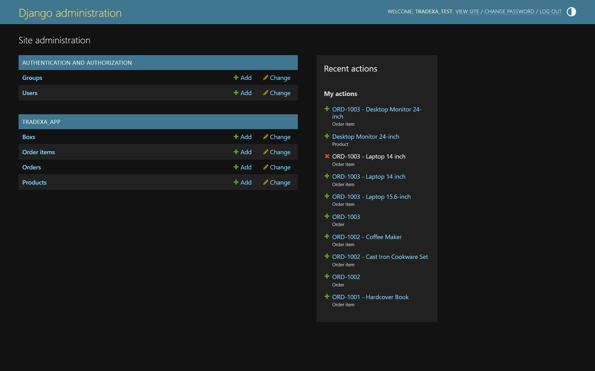

---

## Step 2 — Create Order

Products are selected from the Shop page.

The user can adjust quantities and enter:

* Customer name
* Delivery address

The selected products are submitted to Django.

Django creates:

* One `Order`
* Corresponding `OrderItem` records

**Screenshot — Shop / Product Selection**
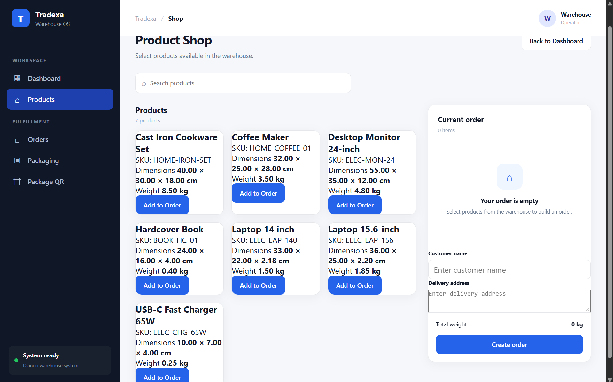

**Screenshot — Create Order**
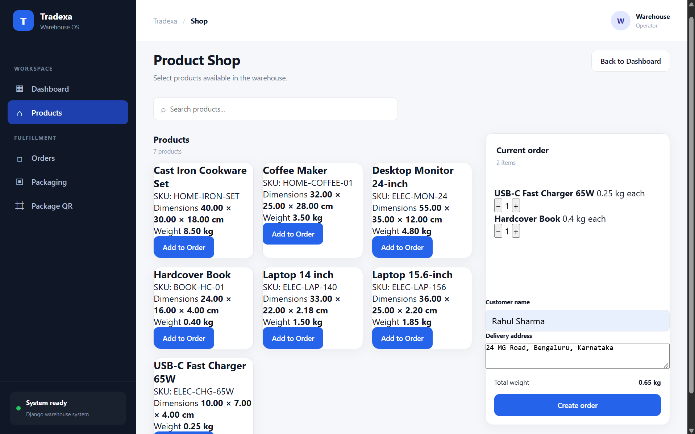


---

## Step 3 — Order List

The Orders page displays orders retrieved from the SQLite database.

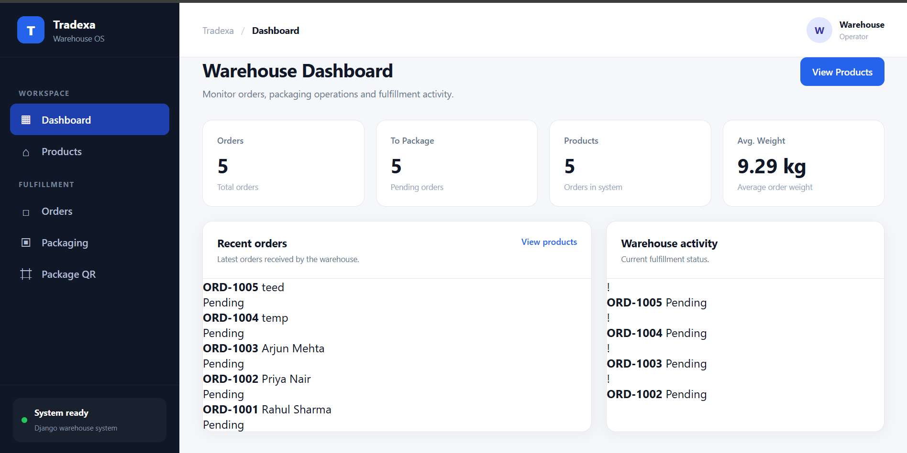

---

## Step 4 — Order Details

Selecting an order opens its detailed information.

The page displays the actual customer, product, quantity, dimensions, weight, and order information stored in the database.

**Screenshot — Order Details**

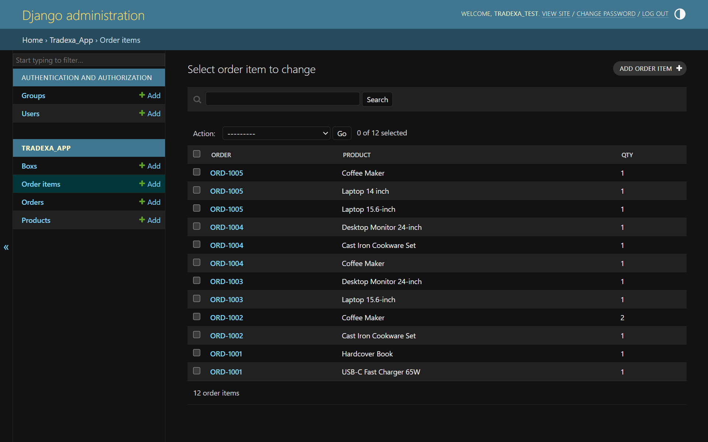

---

## Step 5 — Packaging

The packaging page runs the packaging calculation for the selected order.

The result displays the recommended package information, including:

* Box name
* Box dimensions
* Maximum weight
* Cost
* Products assigned to the package
* Number of packages

**Screenshot — Packaging Result**

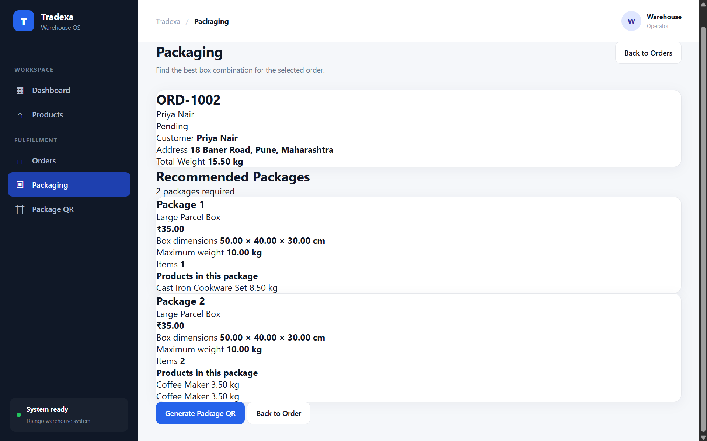

---

## Step 6 — Package QR

The Package QR page provides QR information for the package/order.

**Screenshot — Package QR**

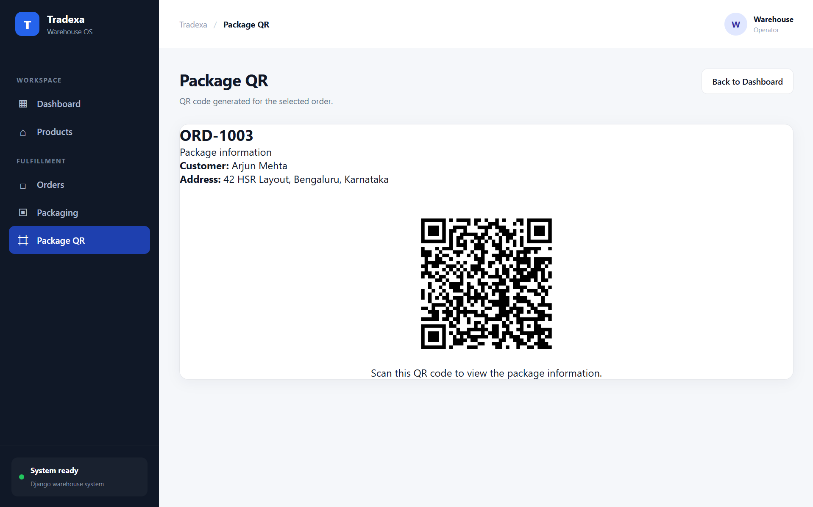

**Screenshot — Scanned QR Result**

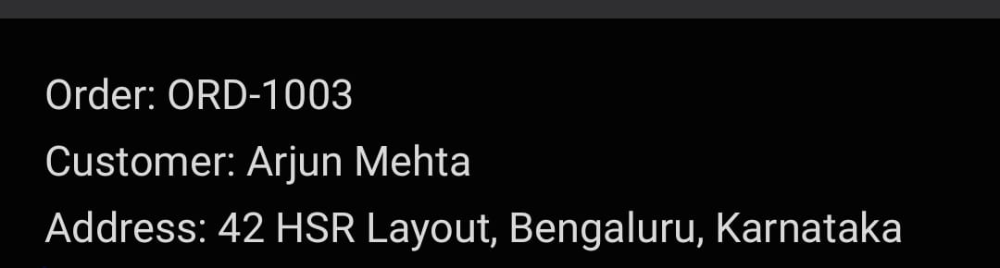

---

# 7. Django Admin

Django Admin is used to manage the application's database records.

The following models are registered:

* Product
* Box
* Order
* OrderItem

### Product Admin

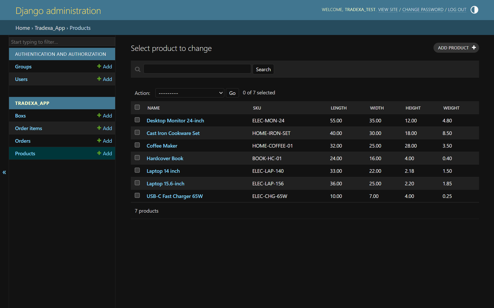

### Box Admin

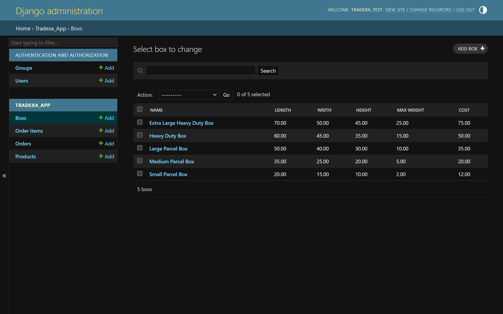

### Order Admin

> 📸 **[PASTE ORDER ADMIN SCREENSHOT HERE]**
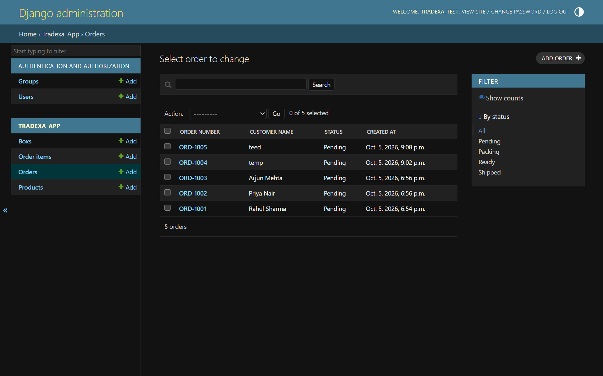

### Order Item Admin


---

# 8. Project Structure

```text
tradexa_project/
│
├── manage.py
│
├── tradexa_project/
│   ├── settings.py
│   ├── urls.py
│   └── ...
│
├── tradexa_app/
│   ├── migrations/
│   │
│   ├── templates/
│   │   └── tradexa_app/
│   │       ├── base.html
│   │       ├── dashboard.html
│   │       ├── shop.html
│   │       ├── order_detail.html
│   │       ├── packaging.html
│   │       └── package_qr.html
│   │
│   ├── static/
│   │   └── tradexa_app/
│   │       ├── css/
│   │       └── js/
│   │
│   ├── admin.py
│   ├── models.py
│   ├── views.py
│   └── ...
│
├── db.sqlite3
├── README.md
└── AI_USAGE.md
```

---

# 9. Setup Instructions

## 9.1 Create a Virtual Environment

Windows:

```bash
python -m venv venv
```

Activate:

```bash
venv\Scripts\activate
```

macOS/Linux:

```bash
python -m venv venv
source venv/bin/activate
```

---

## 9.2 Install Dependencies

If `requirements.txt` is provided:

```bash
pip install -r requirements.txt
```

---

## 9.3 Apply Migrations

```bash
python manage.py migrate
```

---

## 9.4 Create Superuser

```bash
python manage.py createsuperuser
```

---

## 9.5 Run the Application

```bash
python manage.py runserver
```

Open:

```text
http://127.0.0.1:8000/
```

Django Admin:

```text
http://127.0.0.1:8000/admin/
```

---

# 10. Testing

Testing was performed at both the backend function level and through the complete application workflow.

## 10.1 Django System Check

Command executed:

```bash
python manage.py check
```

### Result

> 📸 **[PASTE `python manage.py check` OUTPUT SCREENSHOT HERE]**

---

## 10.2 Automated Django Tests

Command executed:

```bash
python manage.py test
```

### Result

> 📸 **[PASTE ACTUAL `python manage.py test` OUTPUT SCREENSHOT HERE]**

The screenshot above shows the actual test result produced by the submitted project.

---

# 11. Packaging Function Tests

The core packaging functions were tested during development.

### Functions tested

```text
get_order_weight()
product_fits()
get_best_box()
get_multi_box_packaging()
```

### Test 1 — Order Weight

Command/test performed:

```python
get_order_weight(order)
```

Expected behavior:

The function returns the total weight of all products in the order, taking product quantities into account.

**Test Result**

> 📸 **[PASTE ORDER WEIGHT TEST SCREENSHOT HERE]**

---

### Test 2 — Product Fits Small Box

Command/test performed:

```python
product_fits(product, box)
```

The charger/small-box case was tested.

**Test Result**

> 📸 **[PASTE PRODUCT FIT TEST SCREENSHOT HERE]**

---

### Test 3 — Product Does Not Fit

A monitor/small-box case was tested to verify that an oversized product is rejected.

**Test Result**

> 📸 **[PASTE PRODUCT DOES NOT FIT SCREENSHOT HERE]**

---

### Test 4 — Best Box

The `get_best_box()` function was tested against an actual order.

**Test Result**

> 📸 **[PASTE BEST BOX TEST SCREENSHOT HERE]**

---

### Test 5 — Multiple Box Packaging

The `get_multi_box_packaging()` function was tested against an actual order.

**Test Result**

> 📸 **[PASTE MULTI-BOX TEST SCREENSHOT HERE]**

---

# 12. End-to-End Application Testing

The complete application workflow was manually tested.

```text
Shop
 ↓
Product Selection
 ↓
Create Order
 ↓
Order Saved to SQLite
 ↓
Order List
 ↓
Order Details
 ↓
Packaging
 ↓
Package QR
```

## End-to-End Test

### Step 1 — Product Selection

> 📸 **[PASTE SCREENSHOT HERE]**

### Step 2 — Order Creation

> 📸 **[PASTE SCREENSHOT HERE]**

### Step 3 — Order Created Successfully

> 📸 **[PASTE SCREENSHOT HERE]**

### Step 4 — Order Appears in Order List

> 📸 **[PASTE SCREENSHOT HERE]**

### Step 5 — Order Details

> 📸 **[PASTE SCREENSHOT HERE]**

### Step 6 — Packaging Recommendation

> 📸 **[PASTE SCREENSHOT HERE]**

### Step 7 — Package QR

> 📸 **[PASTE SCREENSHOT HERE]**

### Step 8 — QR Scan

> 📸 **[PASTE SCREENSHOT HERE]**

---

# 13. Edge Case Testing

The application was also tested for cases where normal packaging is not possible.

## No Suitable Package

An order containing products whose combined requirements exceed the available packaging constraints was tested.

The application should display a no-suitable-package result instead of failing.

**Test Result**

> 📸 **[PASTE NO-SUITABLE-PACKAGE SCREENSHOT HERE]**

---

## Invalid Order

An invalid/non-existing order number was tested to verify that the application handles the case without an unhandled Django error.

Example:

```text
/order/?order=ORD-999999
```

**Test Result**

> 📸 **[PASTE INVALID ORDER SCREENSHOT HERE]**

---

# 14. Database Verification

Orders created through the Shop page were verified in Django Admin.

The verification confirmed that:

* The `Order` record was created.
* The customer name was stored.
* The address was stored.
* The order status was stored.
* The corresponding `OrderItem` records were created.
* Product quantities were stored correctly.

**Screenshot — Created Order in Django Admin**

> 📸 **[PASTE DATABASE/ORDER ADMIN SCREENSHOT HERE]**

**Screenshot — Order Items in Django Admin**

> 📸 **[PASTE ORDER ITEMS SCREENSHOT HERE]**

---

# 15. Browser Testing

The application pages were manually checked using the browser.

The following pages were tested:

* Dashboard
* Shop
* Order List
* Order Details
* Packaging
* Package QR

Browser developer tools were also used to check for frontend JavaScript errors.

**Screenshot — Browser Console**

> 📸 **[PASTE BROWSER CONSOLE SCREENSHOT HERE IF REQUIRED]**

---

# 16. Responsive Testing

The application interface was checked at different browser viewport sizes.

The main pages were checked for:

* Navigation
* Product cards
* Order information
* Packaging cards
* QR interface
* Mobile sidebar behavior

**Screenshot — Responsive/Mobile View**

> 📸 **[PASTE RESPONSIVE SCREENSHOT HERE]**

---

# 17. AI Usage

AI assistance was used during development as a development and learning aid.

It was used for:

* Reviewing implementation approaches
* Frontend development guidance
* Django implementation guidance
* Debugging assistance
* Explaining Django concepts
* Packaging algorithm review
* Testing guidance
* Documentation assistance

The actual AI conversation is provided separately with the assignment.

A detailed record of AI usage is available in:

```text
AI_USAGE.md
```

---

# 18. Limitations

The multi-box packaging algorithm is a simplified greedy implementation.

It does not guarantee a mathematically optimal three-dimensional packing arrangement.

The system is intended to provide practical box recommendations within the scope of the assignment.

The application is also intended as a Django warehouse management assignment rather than a production warehouse management system.

---

# 19. Conclusion

The completed application provides a database-driven warehouse packaging workflow using Django and SQLite.

The system supports:

* Product management
* Box management
* Order creation
* Order management
* Order item management
* Order weight calculation
* Box suitability checking
* Single-box recommendations
* Multiple-box recommendations
* Packaging analysis
* Package QR generation
* Warehouse dashboard
* Django Admin management

The complete application workflow was manually tested from product selection through order creation, packaging analysis, and package QR generation.

---

# 20. Submission Contents

The submission contains:

```text
Project Source Code
README.md
AI_USAGE.md
SQLite Database
Test Evidence
AI Conversation / Chat Transcript
```

The AI conversation is provided separately as supporting documentation for the AI-assisted development process.
