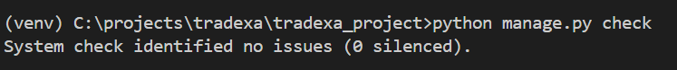
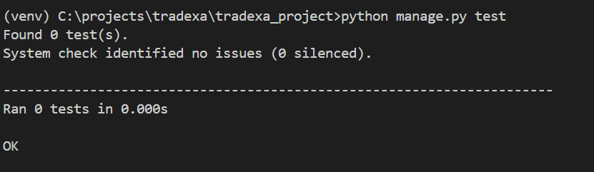
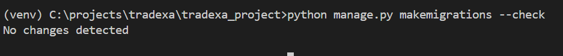
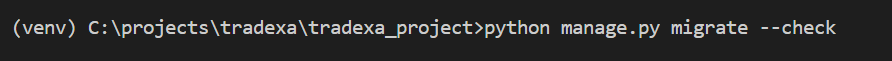

# Test Run Output

This document contains the test and validation commands executed for the Django application.

## 1. Django System Check

### Command

```bash
python manage.py check
```

### Output




---

## 2. Django Test Suite

### Command

```bash
python manage.py test
```

### Output



---

## 3. Migration Check

### Command

```bash
python manage.py makemigrations --check
```

### Output



---

## 4. Database Migration Check

### Command

```bash
python manage.py migrate --check
```

### Output



---

## 5. Manual Application Verification

The application was also manually tested through the main workflow:

```text
Dashboard
    ↓
Shop
    ↓
Create Order
    ↓
Order List
    ↓
Order Details
    ↓
Packaging
    ↓
Package QR
```

The application was tested using the actual Django SQLite database and the application data stored in the database.

### Manual Verification Result
```
- Verifed the functionality of pages.
- Tested the box prediction code with different examples and got expected results.
- Performed additional tests for the multiple-box recommendation system and successfully obtained the expected results.
- QR code is funcational
- Django admin page displays the stored products, boxes, orders and order items.
- Verified that product quantities and total order weight are calculated correctly as intended.

*** Final Verdict Achieved the end result***
Final Verdict: The application was successfully tested and the required end-to-end functionality was achieved.
```